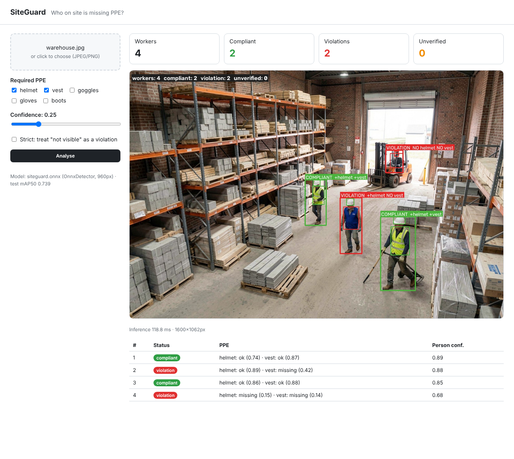
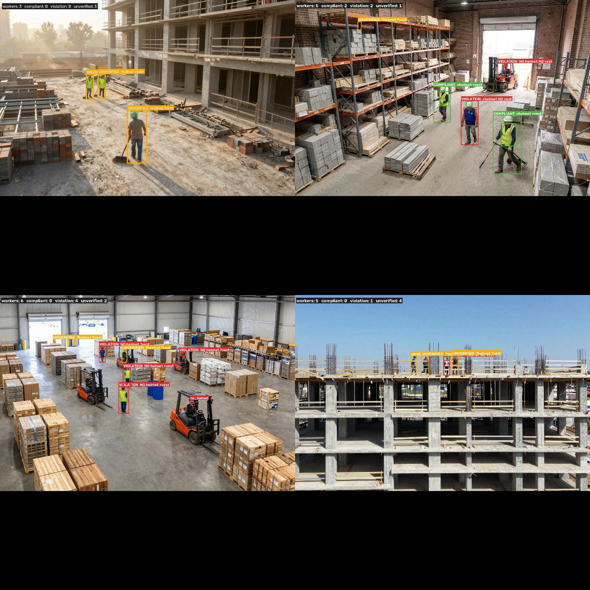
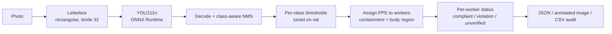

# SiteGuard — PPE compliance detection

**Who on site is missing a helmet or a vest?** SiteGuard fine-tunes YOLO11 on construction-site photos, turns raw detections into a per-worker verdict (*compliant / violation / unverified*), and serves it through a FastAPI service that runs on ONNX Runtime — no PyTorch needed in production.



## Highlights

- **Fine-tuned YOLO11n** on 12 classes (helmet, vest, Person, `no_helmet`, `no_vest`, …) with a clean train / val / **untouched test** split.
- **Worker-level compliance logic**: assigns each helmet/vest to the person wearing it (containment + body-region priors calibrated on the labels), resolves crowds, separates *missing* from *not visible*.
- **Evaluated the way a safety officer would**: "of the workers without a helmet, how many did we flag, and how many did we wrongly call safe?" — not only mAP.
- **Recall-oriented thresholds** tuned on the validation split (F2), reported on the test split.
- **ONNX export with hand-written pre/post-processing** (letterbox, decoding, class-aware NMS): identical detections to PyTorch, 12% faster, ~325 MB serving environment instead of several GB.
- **FastAPI** service + single-page web UI + batch-audit CLI, Docker image, CI, 42 tests.

## Results (held-out test set, 200 images, never used for training or tuning)

**Detection** (YOLO11n trained at 640 px, 20 epochs on CPU):

| Inference size | mAP50 | mAP50-95 |
|---|---|---|
| 640 px | 0.739 | 0.515 |
| **960 px** | **0.766** | **0.521** |

| Class | AP50 @640 | AP50 @960 | | Class | AP50 @640 | AP50 @960 |
|---|---|---|---|---|---|---|
| Person | 0.930 | 0.952 | | `no_helmet` | 0.600 | 0.676 |
| vest | 0.912 | 0.939 | | `no_vest` | 0.721 | 0.706 |
| helmet | 0.820 | 0.888 | | `no_goggle` | 0.223 | 0.226 |

**Compliance** — 481 ground-truth workers, 174 without a helmet, 127 without a vest:

| Setting | Helmet: violations caught | Precision | **Missing helmet reported as OK** | Vest: violations caught | Precision | Missing vest reported as OK |
|---|---|---|---|---|---|---|
| 640 px, default thresholds | 55.2% | 95.0% | 11.5% | 61.4% | 92.9% | 9.4% |
| 640 px, tuned | 60.3% | 87.5% | 6.9% | 61.4% | 87.6% | 9.4% |
| 960 px, default | 62.6% | 94.0% | 9.8% | 66.1% | 92.3% | 6.3% |
| **960 px, tuned (shipped)** | **71.8%** | **86.8%** | **4.0%** | **70.9%** | **84.1%** | **3.9%** |

- 93.8% of workers are detected. False alarms on compliant workers: 3.9% (helmet), 2.7% (vest).
- Violations not caught are mostly reported as **unverified** (head/torso not confidently visible), not as compliant. With `strict=true` (escalate unverified), 89% of missing helmets are flagged.
- The dangerous error — a worker without PPE labelled compliant — dropped from 11.5% to 4.0% through two changes measured below.



## How it works



### Compliance rules (`siteguard/compliance.py`)

A detector outputs independent boxes; a safety system needs a verdict per worker.

1. **Assignment** — an item belongs to a person if ≥50% of its box lies inside the person box **and** its centre is in the expected body region (helmet: top 30% of the person, vest: 10–80%). The regions were checked on the training labels: 98.3% of worn helmets fall in the head band; the rest are mostly in crowds where boxes overlap — exactly where the region test stops a helmet being credited to the wrong worker. A helmet carried in the hand does not count as worn.
2. **Conflicts** — each item goes to one person (best containment, tie-break to the smaller box); if both `helmet` and `no_helmet` are found, the more confident one wins.
3. **Three states per item** — `ok`, `missing` (explicit `no_*` detection) and `unknown` (nothing visible: occluded, cropped, too small). Flagging every partially visible worker causes alert fatigue; calling them compliant hides risk. `strict=true` treats unknown as a violation.

### Decisions backed by measurements

| Decision | Evidence |
|---|---|
| Hold out the original val set as **test**, carve a new val set from train | thresholds and epoch selection never see test images |
| Train at 640 px but **infer at 960 px** | `no_helmet` boxes have a median area of 0.06% of the image (~16 px at 640). 960 px: +2.7 mAP50 and helmet violation recall 60% → 72% at the same precision |
| **Per-class thresholds**, tuned for F2 on val | a missed violation costs more than a false alarm. `no_helmet`/`no_vest` ≥ 0.05, `helmet` ≥ 0.45, `vest` ≥ 0.40. Below 0.05 the val curve is non-monotonic (77 instances) → kept 0.05, in the middle of a flat region |
| Count phantom workers in precision | an empty forklift seat detected as a "person" and flagged is a false alarm; the first version of the metric ignored it (vest precision 0.90 → 0.85 once counted) |
| Person threshold left at 0.25 | tuned on val: mean F2 0.754–0.762 across 0.25–0.50 — raising it removes phantom workers but loses as many real small ones |
| ONNX with **dynamic shapes** + rectangular letterbox | static 960×960 input was slower than PyTorch; a 3:2 photo becomes 960×640 → 124 ms vs 141 ms (PyTorch) per image on 2 CPU cores |

### ONNX parity

On 40 test images, the ONNX pipeline (own pre/post-processing) and PyTorch produce **707 vs 707 boxes, 100% matched**, identical confidences, max coordinate deviation 1.04 px on 2048 px images (`scripts/export_onnx.py`, `tests/test_model.py`).

## Quick start

```bash
git clone https://github.com/FranciscoCarvalho23/siteguard && cd siteguard
pip install -r requirements-api.txt          # serving only (no PyTorch)
uvicorn api.main:app --port 8000             # open http://localhost:8000  (API docs at /docs)
```

```bash
curl -F "file=@tests/assets/site.jpg" "localhost:8000/v1/detect?required=helmet,vest"
curl -F "file=@tests/assets/site.jpg" "localhost:8000/v1/detect/annotated" -o checked.jpg
python -m siteguard.cli photos/ --out audit/          # batch audit -> annotated images + report.csv
docker build -t siteguard . && docker run -p 8000:8000 siteguard
```

`POST /v1/detect` parameters: `conf`, `iou`, `required` (helmet, vest, goggles, gloves, boots), `strict`, `include_detections`, `return_image`.

### Reproduce training and evaluation

```bash
pip install -r requirements.txt
python scripts/prepare_data.py                           # download (~650 MB) + train/val/test split
python scripts/train.py                                  # ~110 min on 2 CPU cores; minutes on a GPU (--device 0)
python scripts/tune_thresholds.py --imgsz 960            # on the validation split
python scripts/evaluate.py --model models/ppe_yolo11n_640.pt   # test split -> models/metrics.json
python scripts/export_onnx.py --imgsz 960                # -> models/siteguard.onnx + parity + latency
pytest
```

## Project layout

```
siteguard/   compliance.py  detector.py (ONNX + Ultralytics)  metrics.py  annotate.py  labels.py  cli.py
api/         main.py (FastAPI)  static/index.html
scripts/     prepare_data.py  train.py  tune_thresholds.py  evaluate.py  export_onnx.py
configs/     thresholds_640.json  thresholds_960.json
models/      siteguard.onnx  ppe_yolo11n_640.pt  metrics.json
tests/       compliance, metrics, detector post-processing, API (fake detector), shipped model
```

## Limitations

- **Small dataset** (1,000 images, many visually similar, some synthetic-looking). Expect lower numbers on real CCTV footage; collecting ~200 labelled frames from the target cameras is the first thing to do before deployment.
- **CPU training budget**: 20 epochs of the nano model. Validation mAP was still rising slowly; `yolo11s`/`m` with 100 epochs on a GPU should do noticeably better, especially on `no_helmet`.
- **`no_goggle` is unusable** (AP50 0.22: tiny, rare) — goggles are optional in the API for that reason.
- **Known failure modes**: empty vehicle seats detected as people; workers whose head is cropped become *unverified*.
- Single images only — for video, add tracking (e.g. ByteTrack) and require a violation to persist for N frames before alerting.

## Related projects

- [vigia](https://github.com/FranciscoCarvalho23/vigia) — object detection, multi-object tracking and video analytics (YOLO11 + ByteTrack, Streamlit).
- [pullup-counter](https://github.com/FranciscoCarvalho23/pullup-counter) — real-time pull-up counter with pose estimation (MediaPipe).

## Data & licences

Dataset: [Ultralytics Construction-PPE](https://docs.ultralytics.com/datasets/detect/construction-ppe/) (CC BY 4.0). YOLO11 / Ultralytics: AGPL-3.0. This repository's code: MIT. See [MODEL_CARD.md](MODEL_CARD.md).
